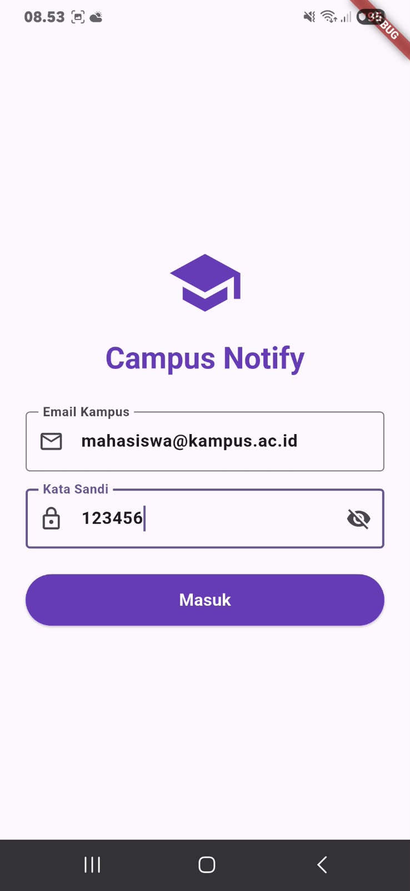
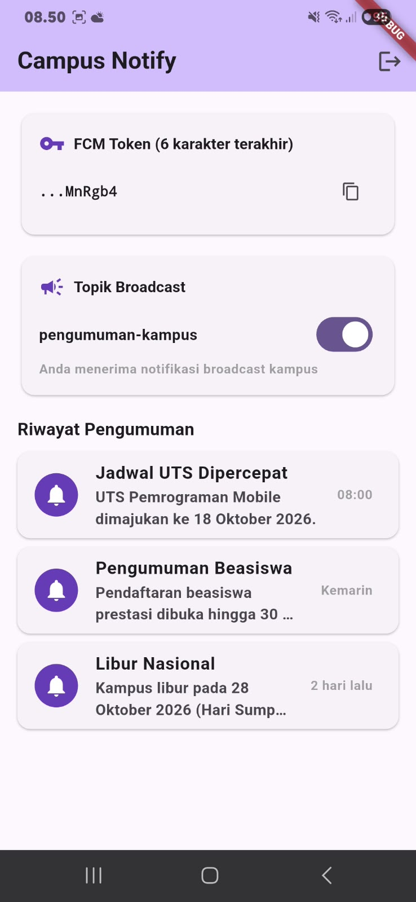
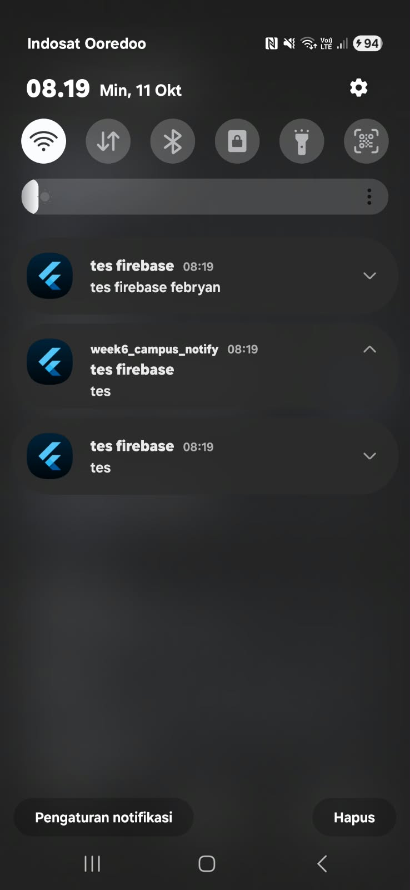
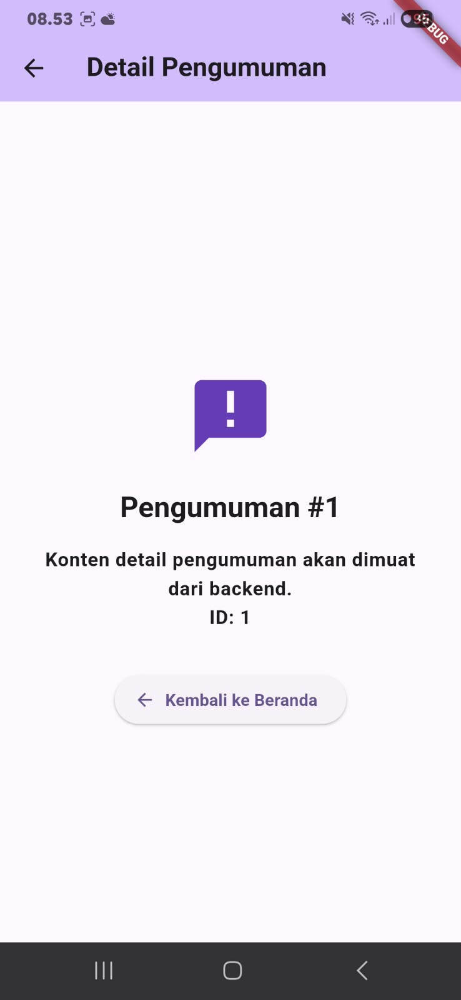

# Campus Notify — Aplikasi Notifikasi Kampus Terintegrasi Firebase Cloud Messaging (FCM), Keamanan & Autentikasi

### Langkah 1: Setup Proyek & Konfigurasi Firebase

1. **Inisialisasi Proyek Flutter:**
   Membuat proyek baru dan menambahkan dependensi utama ke `pubspec.yaml`:
   ```powershell
   flutter create week6_campus_notify
   cd week6_campus_notify
   flutter pub add flutter_riverpod go_router dio flutter_secure_storage
   flutter pub add firebase_core firebase_messaging flutter_local_notifications
   ```

2. **Integrasi Firebase Console:**
   - Membuat proyek baru di [Firebase Console](https://console.firebase.google.com).
   - Menambahkan aplikasi Android dengan `package name` yang sesuai dengan `applicationId` di `android/app/build.gradle.kts`.
   - Mengunduh berkas konfigurasi `google-services.json` dan menyimpannya di folder `android/app/`.
   - Menambahkan plugin Google Services pada file build Gradle native.

3. **Inisialisasi di Entry Point (`lib/main.dart`):**
   Memastikan binding engine Flutter dan Firebase diinisialisasi sebelum rendering aplikasi:
   ```dart
   WidgetsFlutterBinding.ensureInitialized();
   await Firebase.initializeApp();
   ```

---

### Langkah 2: Autentikasi Aman & Token Storage (Praktikum 1)

1. **Penyimpanan Terenkripsi (`lib/data/token_store.dart`):**
   Token tidak boleh disimpan di `SharedPreferences` biasa karena rentan diekstrak dalam bentuk *plain text*. Digunakan `flutter_secure_storage` yang memanfaatkan Android Keystore / iOS Keychain.
   ```dart
   class TokenStore implements SessionTokenStore {
     final FlutterSecureStorage _storage = const FlutterSecureStorage();
     static const _accessKey = 'access_token';
     static const _refreshKey = 'refresh_token';

     Future<void> save({required String access, required String refresh}) async {
       await _storage.write(key: _accessKey, value: access);
       await _storage.write(key: _refreshKey, value: refresh);
     }
     Future<String?> readAccess() => _storage.read(key: _accessKey);
     Future<String?> readRefresh() => _storage.read(key: _refreshKey);
     Future<void> clear() => _storage.deleteAll();
   }
   ```

2. **Mock Auth Repository (`lib/data/auth_repository.dart`):**
   Mensimulasikan endpoint autentikasi kampus dengan memvalidasi format email (`@`) dan password minimal 6 karakter, lalu mengembalikan pasangan token (`access` dan `refresh`).
   ```dart
   class AuthRepository {
     Future<AuthSession> login({required String email, required String password}) async {
       await Future.delayed(const Duration(milliseconds: 500));
       if (!email.contains('@') || password.length < 6) {
         throw Exception('Email atau kata sandi tidak valid');
       }
       return AuthSession(
         access: 'mock-access-for-$email',
         refresh: 'mock-refresh-for-$email',
       );
     }
     Future<String> refresh(String refreshToken) async { ... }
   }
   ```

3. **Dio Auto-Refresh & Retry Interceptor (`lib/data/api_client.dart`):**
   Dio dikonfigurasi untuk menangani *expired token* secara otomatis:
   - Menyisipkan header `Authorization: Bearer <access_token>` pada setiap request.
   - Jika menerima respons HTTP 401:
     1. Mengecek apakah request tersebut sudah pernah di-*retry* sebelumnya (mencegah *infinite loop*).
     2. Mengambil `refresh_token` dari secure storage.
     3. Meminta `access_token` baru ke backend.
     4. Menyimpan access token baru ke secure storage.
     5. Mengulang (*retry*) request awal yang gagal dengan access token baru.
   - Jika proses refresh gagal atau retry tetap 401, sesi otomatis dibersihkan (`clear()`) dan callback `onSessionExpired` memicu logout paksa kembali ke `/login`.

---

### Langkah 3: Integrasi FCM & Token Lifecycle (Praktikum 2)

Dikelola secara terpusat pada `lib/services/fcm_service.dart`:

1. **Runtime Permission (Android 13+ & iOS):**
   Android 13+ (API level 33) mewajibkan izin runtime `POST_NOTIFICATIONS`:
   ```dart
   final settings = await FirebaseMessaging.instance.requestPermission(
     alert: true, badge: true, sound: true,
   );
   ```

2. **Token Registration & `onTokenRefresh`:**
   Token perangkat diambil menggunakan `getToken()` dan dikirim ke backend via `POST /devices`. Listener `onTokenRefresh` **wajib** diimplementasikan karena token dapat berubah sewaktu-waktu (reinstall, clear cache, atau rotasi keamanan berkala oleh Google):
   ```dart
   final token = await FirebaseMessaging.instance.getToken();
   if (token != null) await onToken(token);

   // WAJIB: Backend harus menerima token baru agar tidak terjadi silent failure
   FirebaseMessaging.instance.onTokenRefresh.listen((newToken) async {
     await onToken(newToken);
   });
   ```

3. **Pengiriman Nyata ke Backend via Dio:**
   ```dart
   static Future<void> sendTokenToBackend(Dio dio, String token) async {
     final platform = Platform.isAndroid ? 'android' : 'ios';
     try {
       await dio.post<void>('/devices', data: {'fcm_token': token, 'platform': platform});
     } on DioException catch (e) {
       debugPrint('[FcmService] Gagal kirim token: HTTP ${e.response?.statusCode}');
     }
   }
   ```

4. **Masking Token untuk Keamanan (Security Compliance):**
   Demi keamanan (mencegah *credential leakage* di logcat), token **hanya dicetak 6 karakter terakhirnya**:
   ```dart
   static String _tail(String token) =>
       token.length > 6 ? token.substring(token.length - 6) : token;
   ```

5. **Topic Messaging (`pengumuman-kampus`):**
   Menggunakan FCM Topic Subscription untuk siaran massal tanpa memerlukan daftar token individual:
   ```dart
   await FirebaseMessaging.instance.subscribeToTopic('pengumuman-kampus');
   ```

---

### Langkah 4: Push Notification, 3 App State & Deep Linking (Praktikum 3)

Dikelola pada `lib/messaging/push_service.dart` dan `lib/main.dart`:

1. **Background Handler Top-Level dengan `@pragma('vm:entry-point')`:**
   Handler background dijalankan pada *Dart Isolate* native terpisah tanpa widget tree. Wajib berupa fungsi top-level dan tidak boleh mengakses `BuildContext`:
   ```dart
   @pragma('vm:entry-point')
   Future<void> firebaseMessagingBackgroundHandler(RemoteMessage message) async {
     debugPrint('[BGHandler] FCM id=${message.messageId} route=${message.data["route"]}');
   }
   ```

2. **Inisialisasi Notifikasi Lokal (`flutter_local_notifications`):**
   Mendaftarkan `AndroidNotificationChannel` dengan tingkat kepentingan `Importance.high` agar banner muncul di atas layar:
   ```dart
   const channel = AndroidNotificationChannel(
     'pengumuman', 'Pengumuman Kampus',
     importance: Importance.high,
   );
   ```

3. **Penanganan Tiga State Aplikasi:**
   - **Foreground (Aplikasi Terbuka):** SDK FCM secara default tidak memunculkan banner saat aplikasi aktif. Oleh karena itu, kita menangkap event di `FirebaseMessaging.onMessage` dan memunculkan notifikasi manual menggunakan `_local.show()`.
   - **Background (Aplikasi Diminimize):** Sistem operasi Android/iOS secara otomatis menampilkan banner dari `notification payload`. Ketika banner diketuk, event ditangkap oleh `FirebaseMessaging.onMessageOpenedApp` yang mengarahkan pengguna ke rute `data['route']`.
   - **Terminated (Aplikasi Ditutup/Mati Total):** Ketika aplikasi diluncurkan dari notifikasi, rute ditangkap menggunakan `FirebaseMessaging.instance.getInitialMessage()`, lalu dieksekusi setelah router siap via `handleTerminated()`.

4. **Format Payload Gabungan (Best Practice):**
   ```json
   {
     "message": {
       "topic": "pengumuman-kampus",
       "notification": {
         "title": "Jadwal UTS Dipercepat",
         "body": "UTS Pemrograman Mobile dimajukan ke 18 Oktober 2026."
       },
       "data": {
         "route": "/pengumuman/1",
         "id": "1"
       }
     }
   }
   ```

---

### Langkah 5: Routing Dinamis & Antarmuka Aplikasi (UI)

1. **Sentralisasi Rute (`lib/routes.dart`):**
   Menyediakan fungsi murni `routeFromMessage(Map<String, dynamic> data)` yang menormalisasi prefix slash `/` dan mengarahkan fallback ke `/` jika route kosong.
2. **Auth Guard di GoRouter (`lib/main.dart`):**
   Mengintegrasikan `authStateProvider` ke GoRouter redirect. Mahasiswa yang belum login akan dicegat dan diarahkan ke `/login`, meskipun membuka link notifikasi secara langsung:
   ```dart
   redirect: (context, state) {
     if (authAsync.isLoading) return null;
     final isLoggedIn = authAsync.asData?.value ?? false;
     final onLogin = state.matchedLocation == AppRoutes.login;
     if (!isLoggedIn && !onLogin) return AppRoutes.login;
     if (isLoggedIn && onLogin) return AppRoutes.home;
     return null;
   }
   ```
3. **Halaman Login (`lib/pages/login_page.dart`):**
   Form login bertema modern dengan validasi input, status loading, dan tombol masuk.
4. **Halaman Beranda (`lib/pages/home_page.dart`):**
   Menampilkan kartu status kredensial perangkat (6 karakter token), *switch toggle* untuk berhenti atau berlangganan topik `pengumuman-kampus`, serta kartu riwayat pengumuman.
5. **Halaman Detail Pengumuman (`lib/pages/announcement_page.dart`):**
   Menerima parameter `announcementId` dari URL deep link dan menampilkan detail pesan dengan tombol navigasi kembali ke beranda.

---

### Langkah 6: AI Challenge & Technical Verification

Pada pengerjaan tugas ini, instruksi codelab mengizinkan penggunaan AI Coding Assistant untuk menghasilkan *boilerplate*, namun menuntut verifikasi kritis oleh mahasiswa terhadap bug tersembunyi.

Berikut adalah evaluasi dan perbaikan manual yang dilakukan terhadap draf AI:

| Aspek Evaluasi | Draf Awal AI | Keputusan & Perbaikan Manual | Alasan Teknis |
| :--- | :--- | :--- | :--- |
| **`sendTokenToBackend`** | Hanya `TODO` stub dengan `debugPrint` | Mengganti dengan pemanggilan `dio.post('/devices')` secara riil | Token basi (*stale token*) mengakibatkan pesan hilang (*silent failure*) tanpa error di sisi pengirim. |
| **Log Token FCM** | Menampilkan full registration token | Masking string: hanya mencetak 6 karakter terakhir (`...${tail}`) | Token FCM merupakan kredensial perangkat; pencetakan utuh melanggar OWASP Mobile M9. |
| **Injeksi Dependency Dio** | Menggunakan method statis tanpa Dio | Injeksi parameter Dio dari `apiClientProvider` | Menghindari *global singleton* dan memudahkan testing / mocking request berautentikasi. |
| **Dukungan iOS Foreground** | Hanya konfigurasi Android | Menambahkan `DarwinNotificationDetails(presentAlert: true)` | Pada iOS, banner foreground tidak akan tampil tanpa parameter `presentAlert`. |
| **Arsitektur Navigasi** | `MaterialPageRoute` & `navigatorKey.push()` | Menggunakan `GoRouter.go()` | Mencegah penumpukan route liar di navigation stack saat notifikasi diketuk berulang kali. |
| **Route Protection** | Tidak ada proteksi rute | Mengonfigurasi guard `redirect` pada GoRouter | Mencegah deep link notifikasi membuka halaman rahasia tanpa login terlebih dahulu. |

---

### Langkah 7: Pengujian Unit Otomatis (Testing)

Pengujian logika autentikasi dan parsing route dilakukan secara otomatis tanpa ketergantungan pada backend maupun Firebase sungguhan menggunakan file `test/auth_push_test.dart`.

Menjalankan test:
```powershell
flutter test
```

**Hasil Pengujian:**
```text
00:00 +0: loading test/auth_push_test.dart
00:00 +0: routeFromMessage parses announcement payloads safely
00:00 +1: 401 refreshes once and retries the request with the new access token
00:00 +2: dead refresh token clears session and invokes logout callback
00:00 +3: All tests passed!
```
Seluruh **3 skenario pengujian unit berhasil lolos 100% (PASS)**.

---

## Dokumentasi & Bukti Pengujian (Screenshot)

Berikut adalah bukti dokumentasi visual pengujian aplikasi pada perangkat fisik Android yang tersimpan di direktori `docs/`:

---

### 1. Halaman Login & Proteksi Rute (Auth Guard)

- **File Dokumentasi:** `docs/2.jpeg`
- **Deskripsi:** Tampilan antarmuka `LoginPage` saat pertama kali aplikasi dibuka atau saat pengguna belum memiliki token sesi aktif.
- **Verifikasi Kriteria:** Pengguna tidak dapat melompati halaman ini tanpa memasukkan kredensial valid (`mahasiswa@kampus.ac.id` dan kata sandi minimal 6 karakter). Guard GoRouter memastikan akses langsung ke `/home` atau deep link `/pengumuman/:id` dicegat sebelum proses autentikasi berhasil.

---

### 2. Halaman Beranda (Token Masking & Pengaturan Topik)

- **File Dokumentasi:** `docs/3.jpeg`
- **Deskripsi:** Tampilan antarmuka `HomePage` setelah berhasil login.
- **Verifikasi Kriteria:**
  1. **Masking Kredensial:** Token FCM berhasil diambil dari Google Play Services namun **hanya ditampilkan 6 karakter terakhirnya** (`...MnRgb4`) demi keamanan.
  2. **Topic Subscription:** Tersedia toggle switch untuk topik broadcast `pengumuman-kampus` yang terintegrasi langsung dengan Firebase Messaging API.
  3. **Riwayat Pengumuman:** Daftar pengumuman yang dapat diklik langsung untuk menuju detail pengumuman.

---

### 3. Notifikasi Push FCM Masuk di System Tray Android

- **File Dokumentasi:** `docs/1.jpeg`
- **Deskripsi:** Pengujian pengiriman pesan notifikasi push dari Firebase Console / backend saat aplikasi berada di latar belakang (*background state*).
- **Verifikasi Kriteria:** Notifikasi broadcast `"tes firebase"` dan `"tes firebase febryan"` berhasil diterima oleh perangkat Android dan muncul di system notification bar secara realtime lengkap dengan icon launcher aplikasi.

---

### 4. Navigasi Deep Link ke Detail Pengumuman

- **File Dokumentasi:** `docs/4.jpeg`
- **Deskripsi:** Tampilan `AnnouncementPage` yang terbuka secara otomatis saat banner notifikasi dengan payload `data.route = "/pengumuman/1"` diketuk oleh pengguna.
- **Verifikasi Kriteria:** Nilai ID (`ID: 1`) berhasil diparsing secara akurat dari payload pesan FCM, dan navigasi GoRouter berhasil mengarahkan pengguna ke halaman target deep link dengan tombol kembali ke beranda.

---

## Matriks Pengujian 3 State Notifikasi

Pengujian dilakukan menggunakan payload gabungan (*notification + data*):
```json
{
  "message": {
    "topic": "pengumuman-kampus",
    "notification": {
      "title": "Jadwal UTS Dipercepat",
      "body": "UTS Pemrograman Mobile dimajukan ke 18 Oktober 2026."
    },
    "data": {
      "route": "/pengumuman/1",
      "id": "1"
    }
  }
}
```

| State Aplikasi | Aksi / Skenario | Perilaku Sistem & Expected Result | Hasil Pengujian |
| :--- | :--- | :--- | :---: |
| **Foreground** *(Aplikasi sedang aktif dibuka)* | Notifikasi dikirim saat user berada di halaman Home | Banner lokal muncul manual via `flutter_local_notifications`. Ketika banner diklik, aplikasi berpindah ke `/pengumuman/1`. | **PASS** ✅ |
| **Background** *(Aplikasi diminimize / tekan tombol Home)* | Notifikasi dikirim saat aplikasi di background | Banner notifikasi sistem Android muncul di tray. Ketika banner diklik, aplikasi terangkat ke layar dan langsung menuju `/pengumuman/1`. | **PASS** ✅ |
| **Terminated** *(Aplikasi di-force stop / swipe-close)* | Notifikasi dikirim saat aplikasi mati total | Banner notifikasi sistem muncul di status bar. Ketika banner diklik, sistem me-launch aplikasi, melewati inisialisasi router, dan membuka `/pengumuman/1`. | **PASS** ✅ |

---


## Refleksi & Analisis Keamanan

### 1. Mengapa refresh token tidak boleh disimpan di `SharedPreferences`? Apa risikonya bila bocor?
`SharedPreferences` di Android menyimpan data dalam berkas XML tanpa enkripsi (*plain text*) di direktori `/data/data/<package_name>/shared_prefs/`. Jika perangkat di-*root*, terkena serangan *malware*, atau data dicadangkan (*insecure backup*), penyerang dapat membaca nilai token dengan sangat mudah. 
Bila **refresh token** bocor, penyerang dapat menggunakannya untuk terus-menerus meminta access token baru atas nama korban tanpa perlu mengetahui kata sandi pengguna, bahkan setelah access token lama kedaluwarsa. Oleh sebab itu, refresh token **wajib** disimpan di `flutter_secure_storage` yang memanfaatkan perangkat keras keamanan (Keystore di Android dan Keychain di iOS).

### 2. Apa yang rusak bila `onTokenRefresh` diabaikan selama satu semester perkuliahan?
FCM Registration Token tidak bersifat permanen. Token dapat dirotasi oleh Firebase ketika aplikasi di-reinstall, data aplikasi dibersihkan, perangkat dipulihkan dari cadangan, atau terjadi rotasi periodik keamanan.
Jika listener `onTokenRefresh` diabaikan dan tidak mengirimkan token baru ke database backend:
- Backend kampus akan terus mengirimkan notifikasi ke token lama yang sudah mati.
- FCM API server akan menolak pengiriman dengan status `registration-token-not-registered`.
- Mahasiswa tidak akan pernah menerima pengumuman penting (jadwal ujian, pembatalan kuliah, info beasiswa) selama satu semester tanpa adanya pesan error yang tampak di sisi aplikasi (*silent failure*).

### 3. Kapan memakai Topik (*Topic*) dan kapan memakai Token Perangkat (*Device Token*)?
- **Topik Broadcast (`FirebaseMessaging.subscribeToTopic`):** Digunakan untuk pesan massal publik yang ditujukan kepada kelompok pengguna tanpa perlu backend mencatat token masing-masing mahasiswa satu per satu.  
  *Contoh kasus kampus:* Pengumuman libur nasional, siaran darurat cuaca/bencana, atau info pendaftaran wisuda satu angkatan.
- **Token Perangkat Individual (`fcm_token`):** Digunakan untuk pesan privat/personal yang hanya boleh dilihat oleh satu pengguna tertentu demi menjaga kerahasiaan data (privasi).  
  *Contoh kasus kampus:* Notifikasi pengumuman nilai hasil ujian, tagihan pembayaran UKT, atau persetujuan kartu rencana studi (KRS) oleh dosen pembimbing.

### 4. Bagian mana dari draf AI yang Anda tolak atau perbaiki, dan mengapa?
1. **Penolakan Stub pada `sendTokenToBackend`:** Draf awal AI hanya menuliskan komentar `// TODO:` dan mencetak token ke log. Ini ditolak karena token lifecycle menjadi tidak berguna tanpa adanya *HTTP POST* riil ke endpoint `/devices`.
2. **Penolakan Pencetakan Token Penuh:** Draf AI mencetak full registration token ke terminal untuk alasan debugging. Ini ditolak dan diperbaiki dengan fungsi masking (hanya mencetak 6 karakter terakhir) demi mematuhi regulasi OWASP Mobile Top 10 terkait kebocoran data sensitif di log perangkat.
3. **Penolakan Navigasi Manual `MaterialPageRoute`:** Draf AI menggunakan push route manual yang merusak integrasi deep link. Diperbaiki dengan mengintegrasikan `GoRouter.go()` dan *auth guard redirect* agar pengguna yang belum login tidak bisa mengakses halaman pengumuman sensitif dari notifikasi luar.


---

## Bukti Mesin Hijau (Week 8 — Mid Project Review)

### `flutter analyze`

```
> flutter analyze
Analyzing week6_campus_notify...
No issues found! (ran in 10.2s)
```

### `flutter test`

```
> flutter test
00:01 +25: All tests passed!
```

Rincian 25 test:
- `test/core/format_test.dart` — parseRoute normalization (2 test)
- `test/auth_push_test.dart` — token refresh, retry 401, payload parsing, session expiry (14 test)
- `test/features/announcements/` — entity, model, repository, use case (6 test)
- `test/features/auth/` — login use case validation & auth failure (4 test)

### Dokumentasi Review

- [`docs/review-checklist.md`](docs/review-checklist.md) — Checklist kesiapan tengah semester
- [`docs/ai-review-vs-keputusan.md`](docs/ai-review-vs-keputusan.md) — Tabel usulan AI vs keputusan final + bukti grep
