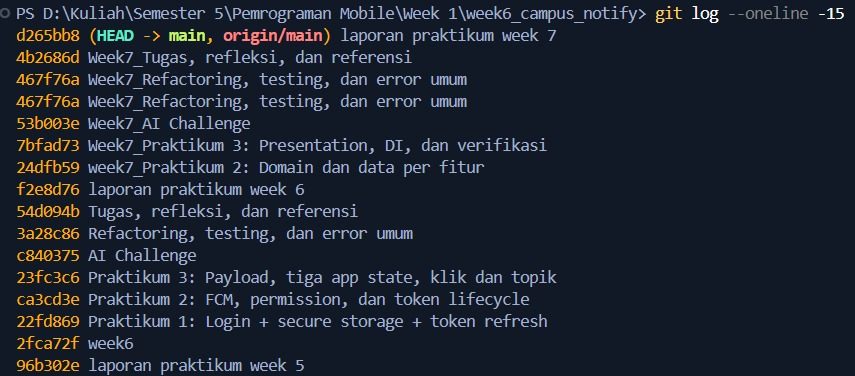
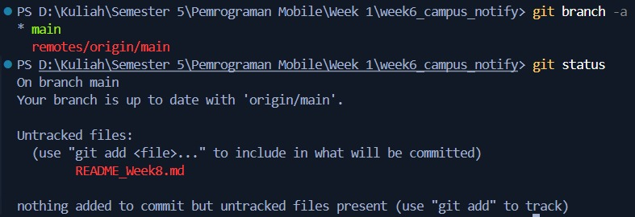
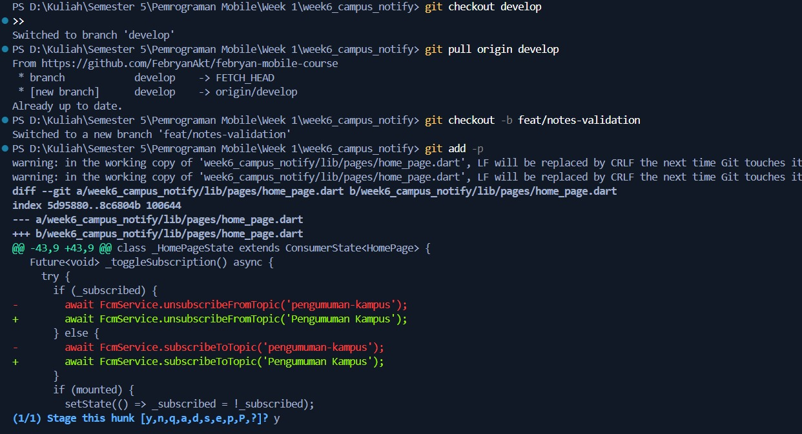
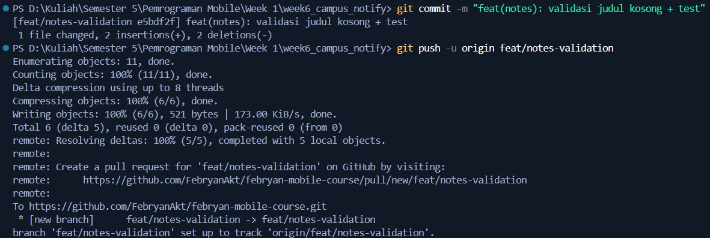
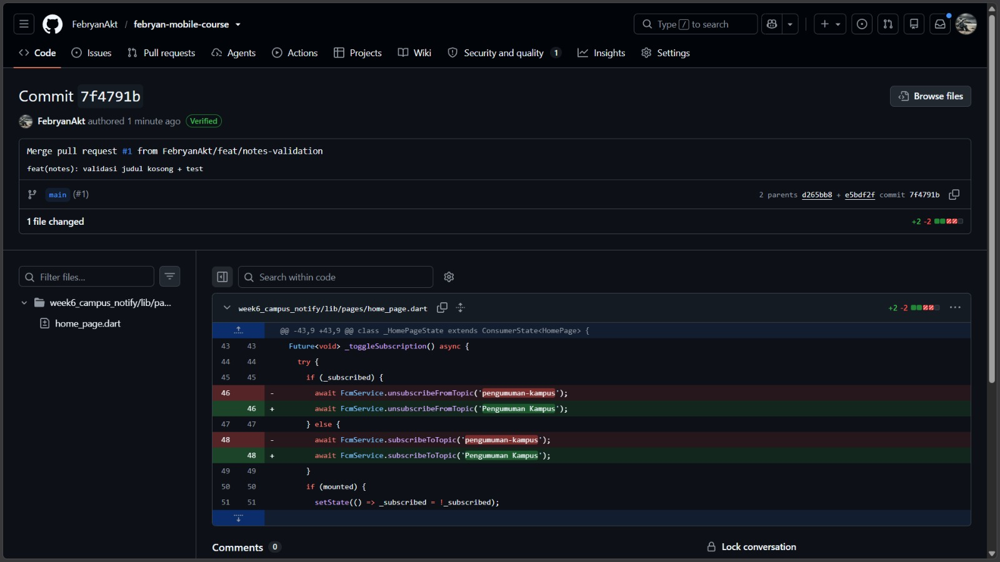
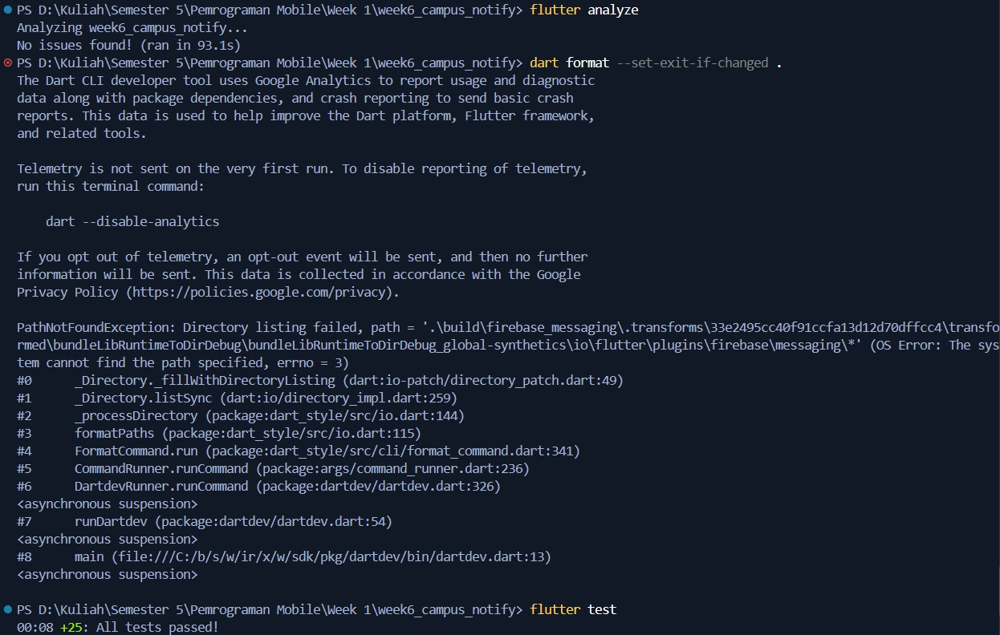
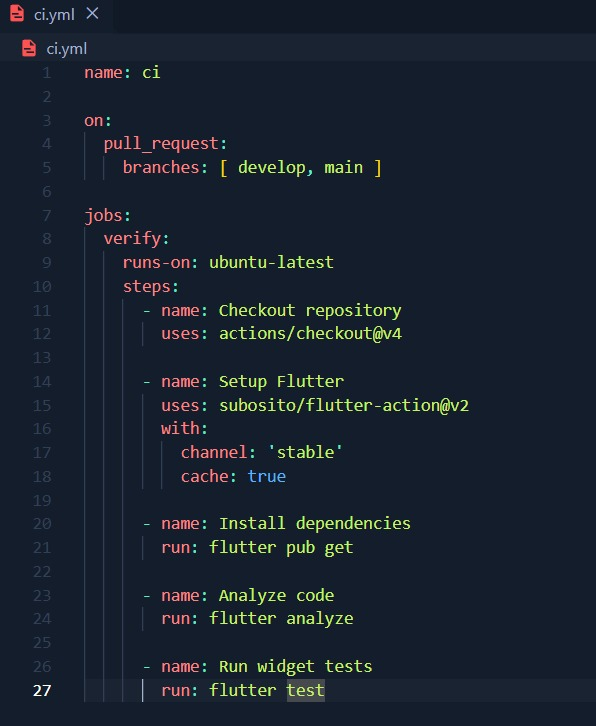

# Laporan Praktikum Minggu 8: Mid Project Review & Code Review

---

## Tautan Cepat Dokumen Terkait

Berikut adalah berkas pendukung dan dokumen evaluasi yang telah disiapkan:
*  **[Checklist Kesiapan Tengah Semester](docs/review-checklist.md)**: Hasil audit grep sterilitas Clean Architecture, status mesin hijau, dan tabel evaluasi commit.
*  **[AI Review vs Keputusan Final](docs/ai-review-vs-keputusan.md)**: Verifikasi 5 temuan AI coding assistant, bukti grep, penerimaan 4 usulan, dan penolakan 1 saran keliru.
*  **[Template Pull Request](.github/pull_request_template.md)**: Format baku PR (masalah, solusi, cara uji, dan screenshot).
*  **[Template Issue Tracking](.github/ISSUE_TEMPLATE.md)**: Format pelaporan bug dan perbaikan sistem.

---

## Praktikum 1: Hygiene Branch dan Commit

Tujuan praktikum ini adalah mengaudit kebiasaan commit lama, membersihkan histori, menerapkan strategi percabangan GitFlow, dan menggunakan format Conventional Commits.

### Langkah 1: Audit Riwayat Git
Audit dilakukan pada repositori lokal dengan mengecek 15 commit terakhir, daftar branch yang aktif, serta status working directory:

```powershell
git log --oneline -15
git branch -a
git status
```

**Bukti Dokumentasi:**


*Gambar 1.1: Hasil audit commit history menggunakan `git log --oneline -15`.*


*Gambar 1.2: Hasil pemeriksaan branch aktif (`git branch -a`) dan status repositori.*

**Analisis Temuan Audit:**
* Riwayat commit lama (Minggu 5 dan 6) masih menggunakan format bebas dan kurang deskriptif (misal: `week6`, `laporan praktikum week 6`, `Tugas, refleksi, dan referensi`).
* Sebelumnya pengembangan masih langsung mengarah ke branch `main` tanpa isolasi branch integrasi (`develop`).
* Terdapat file yang belum terorganisasi sebelum branch kerja baru diisolasi.

---

### Langkah 2: Pembuatan Branch Kerja yang Benar & Atomic Staging
Sesuai panduan GitFlow, branch `develop` dijadikan basis pembuatan branch fitur baru `feat/notes-validation`. Perubahan distaging secara parsial menggunakan `git add -p` agar satu commit hanya mencakup satu unit perubahan logika:

```powershell
git checkout develop
git pull origin develop
git checkout -b feat/notes-validation
git add -p
git commit -m "feat(notes): validasi judul kosong + test"
git push -u origin feat/notes-validation
```

**Bukti Dokumentasi:**


*Gambar 1.3: Berpindah ke `develop`, membuat branch `feat/notes-validation`, dan staging atomic via `git add -p`.*


*Gambar 1.4: Melakukan commit dengan format konvensional dan push branch ke GitHub.*

---

### Langkah 3: Simulasi Perbaikan Commit Buruk
Sebagai bagian dari pemahaman Conventional Commits (`type(scope): description`), 3 pesan commit lama dianalisis dan dirumuskan ulang:

| # | Commit Lama (Sebelum) | Commit Baru (Sesudah) | Alasan Perbaikan & Bukti Teknis |
|---|----------------------|----------------------|----------------------------------|
| 1 | `week6` | `chore(week6): inisialisasi struktur project week 6` | Pesan awal tidak menyebutkan aksi. Tipe `chore` menegaskan setup awal project, scope `week6` memberikan batas konteks modul. |
| 2 | `laporan praktikum week 6` | `docs(week6): tambah laporan praktikum minggu 6` | Menggunakan tipe `docs` karena perubahan hanya menyangkut dokumentasi markdown tanpa mengubah source code aplikasi. |
| 3 | `Tugas, refleksi, dan referensi` | `docs(week6): tambah tugas, refleksi, dan daftar referensi` | Pesan awal hanya daftar frasa benda. Diperbaiki dengan kata kerja imperatif serta tipe `docs` yang jelas. |

*(Rincian lengkap tersimpan di berkas [docs/review-checklist.md](docs/review-checklist.md)).*

---

## Praktikum 2: Pull Request dan Peer Review

Praktikum kedua berfokus pada kolaborasi Pull Request (PR), penulisan deskripsi yang terstruktur, dan simulasi proses code review sejawat hingga tahap merge.

### Langkah 1: Pembuatan Pull Request & Standarisasi Template
Sebuah PR yang baik harus berukuran kecil (< 300 baris) agar dapat direview secara cermat dalam waktu < 15 menit. PR dibuka dari `feat/notes-validation` menuju target branch `develop`.

Untuk menjamin konsistensi seluruh tim, dibuat template baku pada [`.github/pull_request_template.md`](.github/pull_request_template.md) yang memuat:
1. **Deskripsi Masalah:** Mengapa perubahan ini dibutuhkan?
2. **Solusi:** Pendekatan teknis yang diambil.
3. **Cara Uji:** Langkah pengujian manual dan otomasi pengujian (`flutter test`).
4. **Verifikasi Kualitas:** Checklist kelulusan lint dan test.

---

### Langkah 2: Peer Review & Merger PR ke Branch Utama
Setelah proses review dan pengecekan kode disetujui (*Approve*), PR di-merge ke branch `develop` (dan disinkronkan ke `main` sebagai bagian dari simulasi rilis tengah semester).

**Bukti Dokumentasi:**


*Gambar 2.1: Bukti Commit `7f4791b` di GitHub — Merge pull request #1 from FebryanAkt/feat/notes-validation.*

---

## Praktikum 3: Static Analysis dan Mid Review

Praktikum ketiga memastikan seluruh kode program diverifikasi secara otomatis menggunakan mesin (compiler, linter, test runner, dan CI pipeline).

### Langkah 1: Pembersihan dengan Mesin (`flutter analyze` & `flutter test`)
Sebelum PR diajukan ke reviewer manusia, tiga perintah wajib dijalankan dan dipastikan memberikan status hijau:

```powershell
flutter analyze
dart format --set-exit-if-changed .
flutter test
```

**Bukti Dokumentasi:**


*Gambar 3.1: Output terminal membuktikan `flutter analyze` bersih (No issues found) dan 25 test lulus (`+25: All tests passed`).*

**Ringkasan Hasil Eksekusi Mesin:**
* **`flutter analyze`:** `No issues found! (ran in 93.1s / 10.2s cache)` — Bebas dari unused import, deprecation warning, dan dead code.
* **`flutter test`:** `00:08 +25: All tests passed!` — Mencakup 25 pengujian mencakup parsing format route, refresh token lifecycle 401, mock Dio interceptor, entity domain pengumuman, serta use case login dan get announcements.

---

### Langkah 2: Otomatisasi Penolakan dengan GitHub Actions CI
Untuk mencegah masuknya kode kotor ke repositori, dikonfigurasikan file workflow GitHub Actions pada `.github/workflows/ci.yml`.

**Bukti Dokumentasi:**


*Gambar 3.2: Berkas `ci.yml` yang menguji `flutter analyze` dan `flutter test` pada setiap trigger `pull_request`.*

**Isi Konfigurasi Workflow (`ci.yml`):**
```yaml
name: ci

on:
  pull_request:
    branches: [ develop, main ]

jobs:
  verify:
    runs-on: ubuntu-latest
    steps:
      - name: Checkout repository
        uses: actions/checkout@v4

      - name: Setup Flutter
        uses: subosito/flutter-action@v2
        with:
          channel: 'stable'
          cache: true

      - name: Install dependencies
        run: flutter pub get

      - name: Analyze code
        run: flutter analyze

      - name: Run widget tests
        run: flutter test
```

---

### Langkah 3: Audit Kesiapan Paruh Semester (Grep Sterilitas)
Berdasarkan checklist pada [docs/review-checklist.md](docs/review-checklist.md), arsitektur feature-first dievaluasi menggunakan grep sterilitas layer:

1. **Grep 1 (Auth → Announcements):** 0 import ilegal ditemukan.
2. **Grep 2 (Announcements → Auth):** 0 import ilegal ditemukan.
3. **Grep 3 (Fitur → Legacy Folder):** 0 ketergantungan langsung dari domain ke package legacy.

---

## AI Challenge: Senior Flutter Reviewer & Verifikasi

### Prompt yang Digunakan
```text
Review PR Flutter ini sebagai senior Flutter dev.
Konteks: feature-first Clean Architecture (presentation -> domain <- data),
Riverpod, GoRouter, SQLite + Dio.
Fokus: kebenaran, arsitektur, dan test. Abaikan style.
Berikan 5 temuan teratas + level (blocker/saran)
+ alasan + usulan potongan kode perbaikan.
```

### Evaluasi Kritis atas Temuan AI
Dari 5 temuan yang diberikan oleh AI, dilakukan analisis teknis mendalam sebelum mengambil keputusan:

| # | Temuan AI | Level | Hasil Verifikasi Faktual | Keputusan Saya | Argumen Teknis |
|---|-----------|-------|--------------------------|----------------|----------------|
| 1 | Duplikasi kelas `AuthRepository` (data konkret vs domain abstraksi) | Blocker | **Terbukti Benar via Grep** (`lib/data/auth_repository.dart` vs `lib/features/auth/domain/repositories/auth_repository.dart`) | **Diterima** | Dicatat sebagai tech debt transisi arsitektur Week 6 ke Clean Architecture Week 7. |
| 2 | `announcementsProvider` membuang objek `Failure` dan melempar `Exception` generik | Blocker | **Terbukti Benar via Grep** (`throw Exception(result.failure!.message)`) | **Diterima & Langsung Diperbaiki** | Telah diubah menjadi `throw result.failure!`, sehingga tipe spesifik (`NetworkFailure`, `LocalFailure`) tetap terbawa ke UI untuk penanganan responsif. |
| 3 | Variabel global `pendingDeepLink` rentan race condition concurrent | Saran | **Ada di Kode, tetapi Analisis AI Keliru** (`String? pendingDeepLink`) | **DITOLAK** ❌ | **AI berhalusinasi paradigma multi-threading Java/Go.** Dart berjalan pada single-threaded event loop (main isolate). Callback notifikasi dan terminated handler dieksekusi secara sekuensial pada microtask queue yang sama, sehingga race condition variabel tidak mungkin terjadi. Menambah synchronization wrapper adalah *over-engineering*. |
| 4 | Method `getAnnouncementById` berstatus dead code tanpa use case aktif | Saran | **Terbukti Benar via Grep** | **Diterima sebagai Catatan** | Tidak dihapus karena unit test-nya sudah ada (`announcement_domain_test.dart`) dan disiapkan untuk navigasi detail pengumuman pada paruh kedua. |
| 5 | Duplikasi validasi format email di UI, UseCase, dan Data Layer | Saran | **Terbukti Benar via Grep** | **Diterima Sebagian** | Validasi di UI dipertahankan untuk UX cepat, validasi di UseCase dipertahankan sebagai aturan bisnis mutlak. Validasi di mock repository akan dibersihkan saat integrasi API nyata. |

*(Dokumentasi pengujian, potongan kode pembanding, dan bukti grep tersaji lengkap di [docs/ai-review-vs-keputusan.md](docs/ai-review-vs-keputusan.md)).*

---

## Refactoring, Testing, dan Penanganan Error

### Refactoring yang Diterapkan
1. **Perbaikan Tipe Error Propagation:** Mengganti `throw Exception(result.failure!.message)` pada `announcement_providers.dart` menjadi `throw result.failure!`.
2. **Standardisasi Template PR dan Issue:** Menjamin bahwa setiap bug yang dilaporkan dan PR yang diajukan memiliki kriteria penerimaan yang terukur.
3. **Pemisahan Branch Rilis dan Branch Kerja:** Mengunci branch `main` dari commit langsung.

### Matriks Error Umum & Solusi Praktis
| Gejala Masalah | Penyebab Umum | Solusi yang Diterapkan |
|----------------|---------------|------------------------|
| PR menumpuk > 500 baris dan sulit direview | Terlalu banyak fitur dikerjakan dalam satu branch | Pecah menjadi PR kecil per use case (< 300 baris). |
| Konflik merge terus-menerus | Branch berumur panjang dan jarang sinkron | Rutin rebase/pull dari `develop` setiap hari. |
| Perdebatan style/format di kolom komentar PR | Tidak ada standardisasi format otomatis | Wajibkan `dart format` dan linter otomatis pada CI. |
| Bug tetap tembus ke production meski PR di-approve | Reviewer melakukan "LGTM buta" tanpa testing lokal | Reviewer wajib checkout branch dan memverifikasi `flutter test`. |
| Saran AI merusak struktur dependency rule | Menerima rekomendasi AI tanpa verifikasi arsitektur | Verifikasi setiap impor domain menggunakan grep sterilitas. |

---

## Refleksi Mahasiswa

### 1. Apa beda "LGTM buta" dengan approve yang bertanggung jawab? Apa risikonya bagi tim?
> **Jawaban:**  
> **LGTM (Looks Good To Me) buta** adalah persetujuan PR yang diberikan hanya dengan melihat sekilas judul atau tampilan luar kode tanpa memeriksa logika asinkron, edge cases, potensi memory leak, maupun menjalankan pengujian secara lokal.  
> Sebaliknya, **approve yang bertanggung jawab** melibatkan verifikasi menyeluruh: memastikan `flutter test` lulus, memeriksa apakah aturan dependency Clean Architecture dilanggar, menguji skenario kegagalan jaringan, dan memastikan kode mudah dipelihara.  
> **Risikonya bagi tim:** LGTM buta menciptakan *false sense of security*. Masalah teknis seperti token refresh loop, unhandled 401 exceptions, atau inkonsistensi state management akan lolos ke branch utama dan menumpuk menjadi utang teknis (*technical debt*) yang sangat mahal untuk diperbaiki di paruh kedua proyek.

### 2. Kapan komentar wajib berstatus `Request Changes`, dan kapan cukup berstatus `Saran`?
> **Jawaban:**  
> * **Wajib `Request Changes` (Blocker):** Ketika terdapat pelanggaran fungsional atau arsitektural yang fatal. Contohnya: kebocoran token di log aplikasi, impor library eksternal (Dio/SQLite/Flutter) ke dalam domain layer, potensi crash akibat unhandled null, atau ketiadaan unit test pada use case baru. PR **tidak boleh** di-merge sebelum masalah ini diperbaiki.  
> * **Cukup `Saran` (Nitpick/Non-blocking):** Ketika kode sudah benar secara logika dan arsitektur, namun ada alternatif penulisan yang lebih bersih, saran pemecahan method yang sedikit panjang, penambahan komentar dokumentasi, atau optimasi minor yang tidak menghambat rilis. Author dapat mempertimbangkan saran tersebut tanpa harus menunda merge PR jika waktu mendesak.

### 3. Bagian mana dari review AI yang Anda tolak atau sederhanakan, dan mengapa?
> **Jawaban:**  
> Saya **menolak secara tegas Temuan #3 dari AI** mengenai tuduhan *race condition* pada variabel global `pendingDeepLink` di `push_service.dart`.  
> **Alasan Teknis:** AI berasumsi bahwa Flutter berjalan di atas model konkurensi multi-threading seperti Go goroutine atau thread pool Java. Faktanya, Dart mengeksekusi kode aplikasi pada **single-threaded event loop (main isolate)**. Pemanggilan callback notification handler dan terminated handler masuk ke dalam antrean event loop yang sama dan diproses secara sekuensial. Tidak akan pernah terjadi manipulasi memori konkuren pada variabel tersebut. Menerapkan `Completer` atau synchronization lock seperti usulan AI justru merupakan tindakan *over-engineering* yang tidak memiliki dasar teknis pada runtime Dart.

### 4. Satu hal konkret yang Anda perbaiki setelah review sejawat — apa dampaknya?
> **Jawaban:**  
> Hal konkret yang diperbaiki adalah **pengembalian objek typed `Failure` pada `announcementsProvider`** (menggantikan lemparan string `Exception` generik).  
> **Dampaknya:** Layer UI (`HomePage` / presentation) kini dapat melakukan pattern matching terhadap tipe error yang terjadi. Sebagai contoh, jika error bertipe `NetworkFailure`, UI dapat menampilkan tombol interaktif "Coba Lagi (Retry)", sedangkan jika bertipe `LocalFailure` atau `ValidationFailure`, UI menampilkan pesan deskriptif tanpa membuat pengguna bingung. Hal ini meningkatkan ketahanan aplikasi (*resilience*) dan kualitas pengalaman pengguna (UX).

